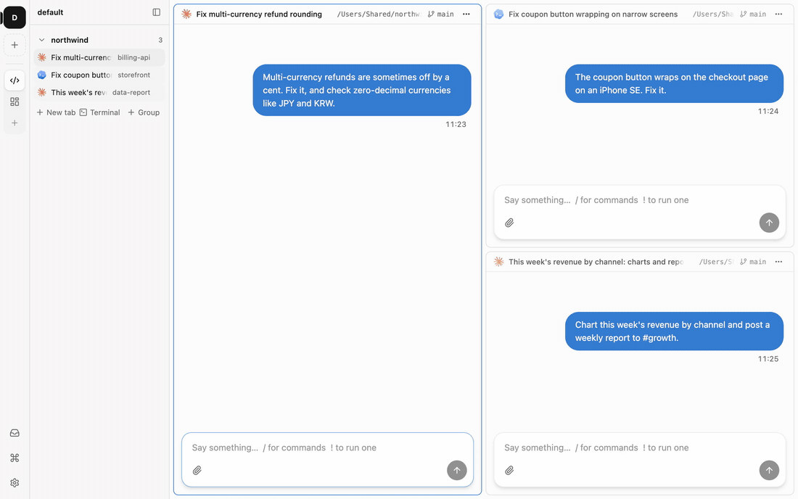
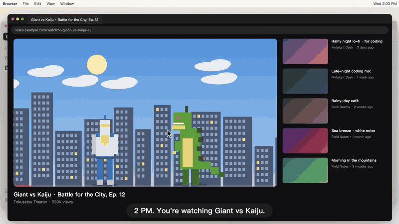
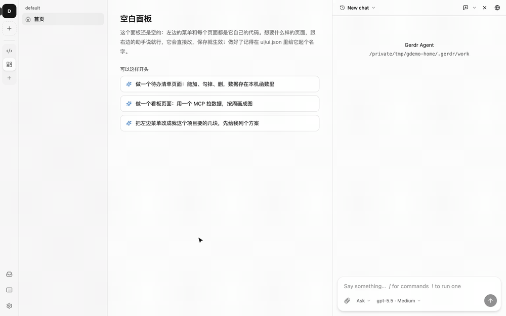

# Gerdr

<p align="center">
  
</p>

<p align="center">
  <a href="#install">install</a> · <a href="docs/guide/usage.md">usage</a> · <a href="docs/guide/vs-herdr.md">Gerdr vs herdr</a> · <a href="docs/API.md">http api</a> · <a href="docs/dev/ARCHITECTURE.md">architecture</a>
</p>

<p align="center">
  English · <a href="README.zh-CN.md">简体中文</a>
</p>

<p align="center">
  <a href="https://github.com/gerdr-dev/gerdr/releases/latest"></a>
  <a href="https://github.com/gerdr-dev/gerdr/releases"></a>
  <a href="https://github.com/gerdr-dev/gerdr/stargazers"></a>
</p>

---

<p align="center"></p>

**One window for all your coding agents.**

Like [herdr](https://github.com/herdrdev/herdr): splits, tabs and workspaces, with one key to zoom a pane, and separate
sessions to keep groups of workspaces apart; when an
agent gets stuck waiting on you, you see it at once and one key takes you there; and agents can talk to each other:
start sessions, hand out work, wait for the replies and read them.

Not at home in a terminal? Gerdr is an equally good choice, as an app: images, videos and PDFs from the agent show right in the chat, and clicking a path
opens the file; away from your desk, keep watching and steering from your phone.

## Superagent: takes in the work from outside

Someone asks for something on Slack or Feishu; the secretary puts it in to do. You add a note, click dispatch, and get
on with your day. The worker messages ops for access and the owner for a merge, and waits; hours later, when it's
done, it calls you: read its report, click send, and the reply goes back to whoever asked. That is the
[Superagent panel](https://github.com/gerdr-dev/gerdr-panel-superagent):

- **the secretary takes messages and lines up tasks** — Slack / Feishu DMs, mentions and alerts reach it first; it
  opens a task, folds the message into one, or lets it go. Say what needs doing and it picks the repository and the agent.
- **you talk to the worker** — one task, one worker; open the task and you are in its chat. It has the most context and
  asks the sharpest questions, so nothing gets relayed through the secretary. Tasks that need you float to the top.
- **the panel does the waiting** — approvals, MR reviews and merges, a colleague's reply: the worker says what it waits
  for and ends its turn, and the panel wakes it when it comes, across restarts and agent swaps.
- **memory** — per-repo rules (MRs or not, who approves releases) and who is waiting on what right now, so incoming
  messages land on the right task.
- **let it go** — sets of rules by the clock for what may be decided without asking you.

<p align="center"></p>

Its UI is in Chinese for now. Install: Settings → Panels → install from GitHub, `https://github.com/gerdr-dev/gerdr-panel-superagent`. For Slack / Feishu (Lark) messages, add the matching add-on from Settings → Add-ons → Store (a bot, or a "DMs" one that uses your own account).

## everything else

**chat**

- **talk while it works** — your message joins the turn that's already running.
- **approvals and questions are cards** — approve a command or an edit, answer a question, in one click.
- **rewind** — go back to before any message; your words return to the input box to edit and resend.
- **pick up old sessions** — Claude Code / Codex sessions started in a terminal, listed per directory.

**agents**

- **beyond Claude and Codex** — several accounts side by side, any ACP agent, and a built-in Gerdr Agent for GPT / DeepSeek APIs.
- **background work in view** — running commands and subagents: stop them, read their full transcripts.

**workspace**

- **terminals** — `ctrl+b t` opens one alongside; it survives reloads and follows you to your phone.
- **worktrees** — several agents on one repository: tell one to "work in a worktree" and they stay out of each other's way; the pane shows its branch, and its terminal and resumed session go with it.
- **coming from herdr** — same keys; import your workspaces, tabs and splits, each agent reattached to its session.

**DIY your own Gerdr**

- **your own workbench** — every project can have its own panels, each a small app: a page on the left, its own
  assistant on the right. Say "make a weekly metrics overview" and the page gets written. Superagent is just such a
  panel, yours to bend to how you work; repositories tagged [`gerdr-panel`](https://github.com/topics/gerdr-panel) install in one step.
- **a UI your agent can change** — the whole interface: add buttons, shortcuts, what gets shown. Just tell the AI;
  no release, no deploy, live at once. Break it and an unbreakable rescue panel gets you back.
- **TypeScript add-ons** — rename tabs, title panes, add commands and keys; install more from a store.
- **skills and MCP** — the agent's own, Gerdr's, or both.

<p align="center"></p>

**anywhere**

- Desktop app (macOS / Windows) or any browser; remote access via relay (pairing codes + passkeys); Android and iOS apps with LAN direct-connect (plus background notifications on Android).

## install

Install and log in to the agents you want to use first:

```bash
curl -fsSL https://claude.ai/install.sh | bash   # Claude Code, then run `claude` once to log in
npm i -g @openai/codex                           # Codex, then `codex login`
```

Then grab Gerdr from [releases](https://github.com/gerdr-dev/gerdr/releases/latest):

- **macOS** — `Gerdr-x.y.z-mac-arm64.dmg` (Apple silicon) or `Gerdr-x.y.z-mac-x64.dmg` (Intel); drag it into
  Applications. If macOS says the developer can't be verified, right-click → Open in Finder
  (or `xattr -dr com.apple.quarantine /Applications/Gerdr.app`).
- **Android** — `Gerdr-x.y.z-android.apk`. It connects to your own Gerdr through [remote access](docs/guide/remote.md).
- **iOS** — not in releases yet; build it with Xcode and install it on your iPhone ([how](docs/dev/IOS.md#building-and-installing)).
  Like Android, it connects through remote access.
- **Windows** — not in releases yet; build the installer with `make win` ([from source](docs/guide/development.md);
  unsigned: on SmartScreen click More info → Run anyway).

Open the app, pick an agent and a directory, and start. Or from a terminal:

```bash
gerdr --open      # start the server and open it in the browser
```

## learn more

- [Using Gerdr](docs/guide/usage.md) — sessions, the input box, rewind, keys
- [Gerdr vs herdr](docs/guide/vs-herdr.md) — what's the same, what's different, which to pick
- [More agents and accounts](docs/guide/agents.md) — a second Claude subscription, ACP agents, the Gerdr Agent for GPT / DeepSeek
- [Remote access](docs/guide/remote.md) — your phone or another computer, via relay or Tailscale
- [Add-ons](docs/guide/addons.md) — TypeScript add-ons and the store
- [Configuration](docs/guide/config.md) — environment variables, security
- [HTTP API](docs/API.md) — scripting sessions and approvals
- [Building and developing](docs/guide/development.md) — from source, tests, architecture
