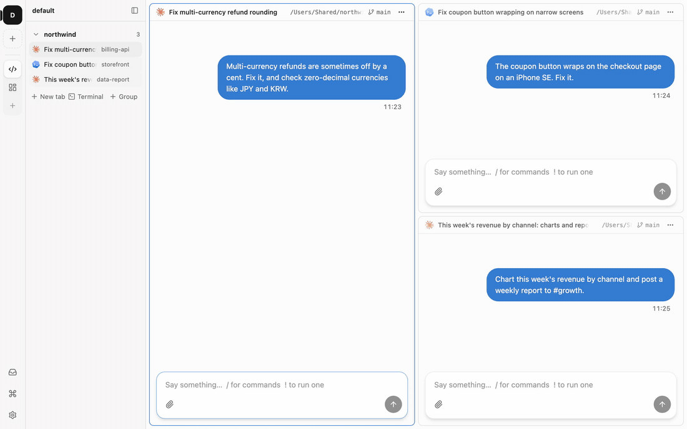
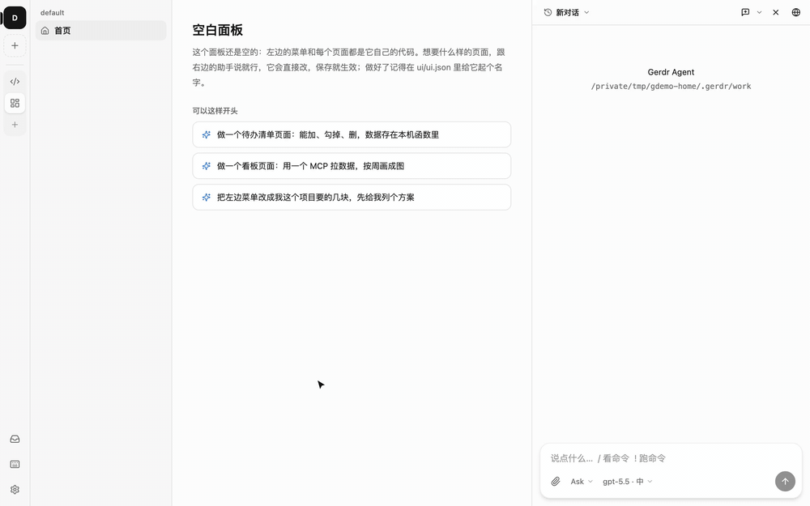

# Gerdr

<p align="center">
  
</p>

<p align="center">
  <a href="#装">安装</a> · <a href="docs/guide/usage.zh-CN.md">使用</a> · <a href="docs/guide/vs-herdr.zh-CN.md">和 herdr 比</a> · <a href="docs/API.md">HTTP 接口</a> · <a href="docs/dev/ARCHITECTURE.md">架构</a>
</p>

<p align="center">
  <a href="README.md">English</a> · 简体中文
</p>

<p align="center">
  <a href="https://github.com/gerdr-dev/gerdr/releases/latest"></a>
  <a href="https://github.com/gerdr-dev/gerdr/releases"></a>
  <a href="https://github.com/gerdr-dev/gerdr/stargazers"></a>
</p>

---

<p align="center"></p>

**一个窗口，同时管一群 coding agent。**

和 [herdr](https://github.com/herdrdev/herdr) 一样：分屏、tab、工作空间，一个键把 pane 放大，还能分成几个互相隔离的 session；哪个 agent 卡住在等你，一眼就看到，一个键跳过去；
agent 之间还能互相对话：开新会话、派活、等回复、读回复。

不习惯终端？Gerdr 是另一个同样好的选择，而且是图形界面：agent 给的图片、视频、PDF 直接在对话里看，点一下路径就打开文件；
出门了用手机远程接着看、接着管。

## Superagent：帮你接外面的活

飞书 / Slack 上有人找你，秘书把活接进待办；你补一句备注、点「派出去」，接着做自己的事。要找运维开权限、找负责人合代码，
worker 自己发消息、自己等；几个小时后做完了才叫你：看一眼它的汇报，点「发送」，回复就到了找你的人那里。
这就是 [Superagent 面板](https://github.com/gerdr-dev/gerdr-panel-superagent)：

- **秘书接消息、排任务**：Slack / 飞书私信、@ 你的、告警先到秘书，它判断建任务、并进已有任务还是不接；你一句话交代的事，它挑仓库、挑 agent 派出去。
- **你直接和 worker 说话**：一个任务一个 worker，点开就是它的对话。它上下文最全，问出来的问题也最准，具体的事不隔着秘书转述。要你拍板或亲手做一步时，任务标黄排最前。
- **等人交给面板**：等审批、等 MR 的 review 和合并、等同事回话，worker 说清等什么就结束这一轮，到了面板叫醒它；Gerdr 重启、换 agent 接手都不丢。
- **记忆**：按仓库记规矩（走不走 MR、发布找谁批），按人记眼下谁在等什么，外面来的消息靠它交给对的任务。
- **Let it go**：按时间设几套规矩，决定哪些事可以不问你（比如下班后外面来的活先进待办）。

<p align="center"></p>

安装：设置 → 面板 → 从 GitHub 安装面板，填 `https://github.com/gerdr-dev/gerdr-panel-superagent`。收 Slack / 飞书的消息，再到设置 → 扩展 → 商店装对应的插件（机器人版，或用你本人账号的「私聊」版）。

## 其他功能

**对话**

- **中途插话**：agent 干活时直接说，消息插进正在跑的那一轮。
- **审批 / 提问是卡片**：批命令、批改文件、回答选择题，点一下就行。
- **回退**：回到任何一条消息之前，原话放回输入框，改了再发。
- **接着以前的聊**：终端里开过的 Claude Code / Codex 会话，选目录就能接上。

**agent**

- **不止 Claude 和 Codex**：多账号并排，接任意 ACP agent，还有直接调 GPT / DeepSeek 接口的 Gerdr Agent。
- **看得见后台**：在跑的后台命令和子 agent，能停、能看完整对话。

**工作区**

- **终端**：`ctrl+b t` 在旁边开一个，刷新页面、换到手机上都还在。
- **worktree**：同一个仓库开几个 agent，跟它说「在 worktree 里做」，各干各的互不干扰；pane 顶上显示分支，旁边的终端、恢复的会话都跟过去。
- **从 herdr 搬过来**：快捷键一样；工作空间、tab、分屏原样导入，每个 agent 接上它的会话。

**DIY 自己的 Gerdr**

- **自己的工作台**：每个项目都能有自己的面板，一个面板就是一个小应用：左边是页面，右边是它自己的助手。说一句「做一个本周数据总览」，页面就写出来了。
  Superagent 也只是这样一个面板，可以改成你自己的流程；GitHub 上带 [`gerdr-panel`](https://github.com/topics/gerdr-panel) 标签的仓库都能一键装。
- **界面让 agent 改**：整个界面都可以让 agent 改，添加按钮、快捷键、显示内容，直接跟 AI 说就行。无需发版、无需部署，即刻生效；改坏了有改不坏的急救面板。
- **TS 扩展**：改 tab 名、pane 标题，加命令和快捷键；商店里一键装。
- **skill / MCP**：用 agent 自己的、Gerdr 的，或两者都用。

<p align="center"></p>

**在哪用**

- 桌面 App（mac / Windows）、任意浏览器；经中继远程访问（配对码 + passkey）；安卓和 iOS App 都能局域网直连，安卓还能收后台通知。

## 装

需要先装好、登录好你要用的 agent：

```bash
curl -fsSL https://claude.ai/install.sh | bash   # Claude Code，然后跑一次 claude 登录
npm i -g @openai/codex                           # Codex，然后 codex login
```

在 [releases](https://github.com/gerdr-dev/gerdr/releases/latest) 下载：

- **mac**：`Gerdr-x.y.z-mac-arm64.dmg`（Apple 芯片：M1 及以后）或 `Gerdr-x.y.z-mac-x64.dmg`（Intel），拖进「应用程序」。第一次打开如果提示「无法验证开发者」，
  在 Finder 里右键 → 打开（或 `xattr -dr com.apple.quarantine /Applications/Gerdr.app`）。
- **安卓**：`Gerdr-x.y.z-android.apk`，连的是你自己那台 Gerdr（要先配好[远程访问](docs/guide/remote.zh-CN.md)）。
- **iOS**：发版里还没有，先用 Xcode 自己装到 iPhone 上（[怎么装](docs/dev/IOS.md#building-and-installing)）。和安卓一样走远程访问连你的 Gerdr。
- **Windows**：发版里还没有，先自己 `make win` 打安装包（[从源码构建](docs/guide/development.zh-CN.md)；没签名，SmartScreen 拦的话点「更多信息 → 仍要运行」）。

打开 App，选 agent、选目录，开始。也可以在终端里：

```bash
gerdr --open      # 起服务并在浏览器里打开
```

## 更多

- [怎么用](docs/guide/usage.zh-CN.md)：会话、输入框、回退、快捷键
- [和 herdr 比](docs/guide/vs-herdr.zh-CN.md)：哪里一样、哪里不同、怎么选
- [多个 agent 和账号](docs/guide/agents.zh-CN.md)：第二个 Claude 订阅、ACP agent、直接调 GPT / DeepSeek 的 Gerdr Agent
- [远程访问](docs/guide/remote.zh-CN.md)：手机或别的电脑，走中继或 Tailscale
- [扩展](docs/guide/addons.zh-CN.md)：TypeScript 扩展和商店
- [配置](docs/guide/config.zh-CN.md)：环境变量、安全
- [HTTP 接口](docs/API.md)：用脚本看会话、点审批
- [构建和开发](docs/guide/development.zh-CN.md)：从源码构建、测试、架构
